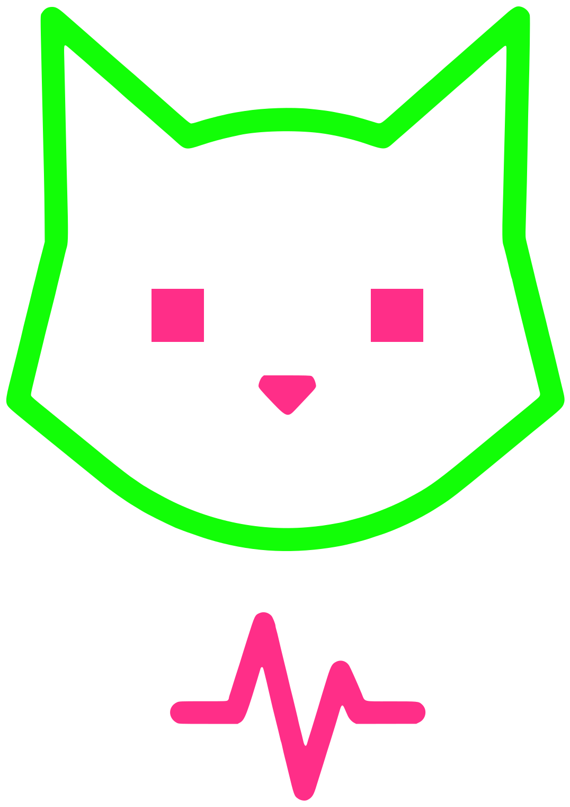
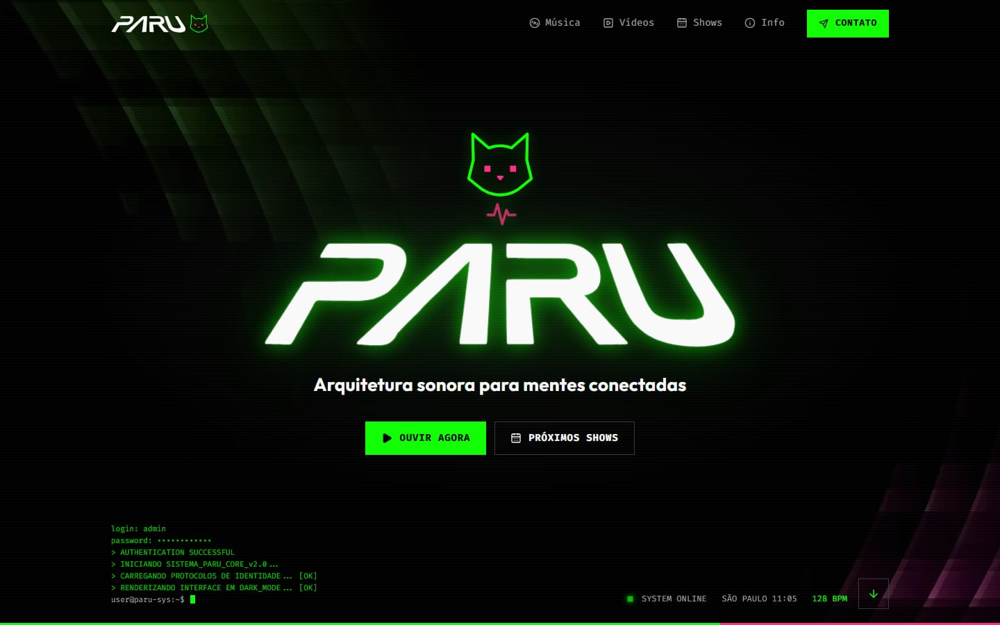
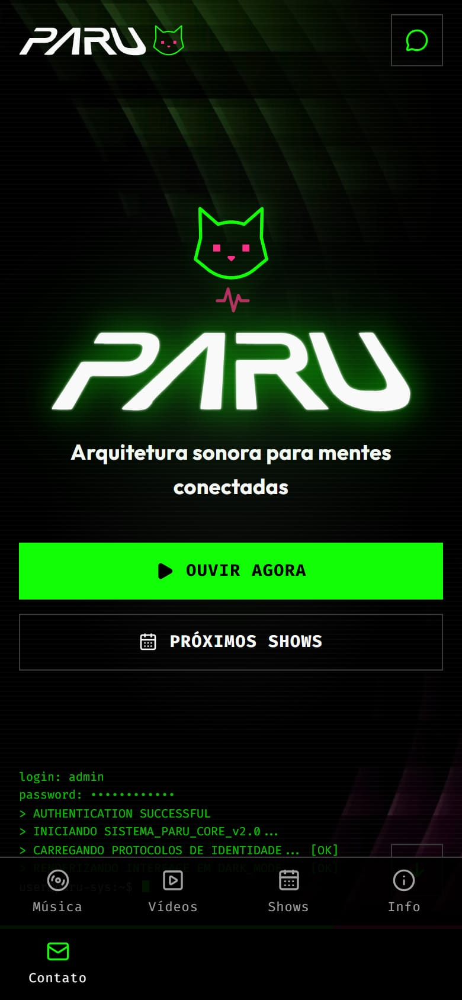
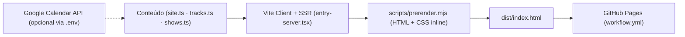
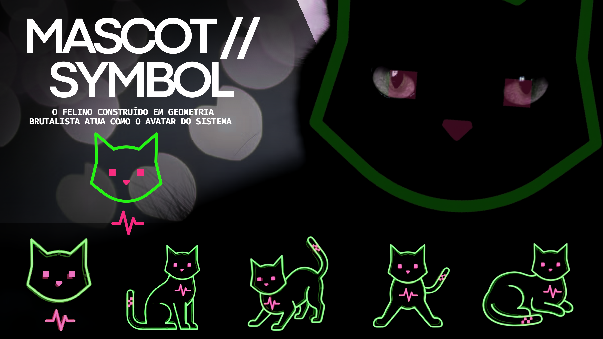

<a id="top"></a>

<div align="center">

<a href="https://voaneves.github.io/paru-site/">
  
</a>

<h1>PARU — Arquitetura Sonora</h1>

<p>
  <strong>Site oficial do DJ e produtor de Indie Dance &amp; Minimal Deep Tech — <em>Arquitetura sonora para mentes conectadas</em>.</strong><br />
  <sub>
    React 19, TypeScript 6 e Vite 8 com pré-renderização SSR fiel ao PARU Brand Guideline —
    <kbd>React 19</kbd> · <kbd>Vite 8</kbd> · <kbd>SSR Prerender</kbd> · <kbd>Oxlint</kbd>
  </sub>
</p>

<p><sub>Precisa de um site autoral assim? <a href="https://voaneves.com/#contato"><strong>Vamos conversar →</strong></a></sub></p>

<p>
  <a href="https://github.com/voaneves/paru-site/actions/workflows/workflow.yml"></a>
  <a href="https://voaneves.github.io/paru-site/"></a>
  
  <a href="./LICENSE"></a>
</p>

<p>
  <a href="https://voaneves.github.io/paru-site/">Site ao vivo</a> ·
  <a href="#visao-geral">Visão geral</a> ·
  <a href="#preview">Preview</a> ·
  <a href="#arquitetura">Arquitetura</a> ·
  <a href="#identidade">Identidade visual</a> ·
  <a href="#edicao-e-execucao">Edição e execução</a> ·
  <a href="#contato">Contato</a>
</p>

</div>

<picture>
  <source media="(prefers-color-scheme: dark)" srcset="https://raw.githubusercontent.com/voaneves/paru-site/main/assets/brand/rule-dark.svg" />
  <source media="(prefers-color-scheme: light)" srcset="https://raw.githubusercontent.com/voaneves/paru-site/main/assets/brand/rule-light.svg" />
  
</picture>

<a id="visao-geral"></a>
## Visão geral

Explore lançamentos, ouça prévias, baixe eventos da agenda em `.ics` e contrate shows do DJ **PARU** diretamente pelo site pré-renderizado.

Planejado, desenhado e implementado por **[Victor Neves](https://voaneves.com)** seguindo fielmente o manual visual do artista ([`plan.md`](./plan.md)).

### Terminal Hero &amp; 128 BPM

`Hero.tsx` reproduz o boot de autenticação do brandbook (`AUTHENTICATION SUCCESSFUL`), relógio ao vivo de São Paulo, barra verde→rosa e indicador rítmico em `128 BPM`.

### Mascote vivo (6 poses oficiais)

`Brand.tsx` anima os olhos pixel rosa seguindo o cursor, enquanto `MascotCompanion.tsx` alterna as poses oficiais (`pounce`, `prowl`, `sit`, `rest`, `stretch`) ao longo das seções.

### Build SSR + CSS embutido

`scripts/prerender.mjs` renderiza `src/entry-server.tsx` durante o build e injeta o CSS compilado direto em `dist/index.html` para primeira pintura imediata no celular.

### Catálogo, agenda &amp; calendário `.ics`

`tracks.ts` gera capas consistentes para faixas sem arte própria; `shows.ts` e `calendarService.ts` funcionam tanto com datas locais quanto integrados à API do Google Calendar.

<a id="preview"></a>
## Preview desktop e mobile

<p align="center">
  <a href="https://voaneves.github.io/paru-site/">
    
  </a>
  <a href="https://voaneves.github.io/paru-site/">
    
  </a>
</p>

<a id="arquitetura"></a>
## Pipeline de build e conteúdo



<a id="identidade"></a>
## Identidade visual e paleta

Extraída da página 15 do brandbook em [`src/index.css`](./src/index.css), com vetores oficiais em [`paru-cat-head.svg`](./public/brand/paru-cat-head.svg) e [`paru-wordmark.svg`](./public/brand/paru-wordmark.svg)[^1]:

- **Chassi / Grafite:** `#1a1a1a` — superfícies e estrutura de hardware
- **Terminal Green:** `#12fe07` — contorno neon do mascote e indicadores ativos
- **Neon Pink:** `#ff2e88` — olhos pixel, pulso ECG e acentos
- **Off-White &amp; Preto:** `#f9f9f9` / `#000000` — contraste principal
- **Texto atenuado:** `#a3a3a3` — legibilidade sobre fundo escuro

**Tipografia:** `Codec Pro` (fallback automático para `Outfit` OFL), `Fira Code` (prompts de terminal) e `Inter` (corpo), auto-hospedadas em `src/fonts/`.

<p align="center">
  
</p>

<a id="edicao-e-execucao"></a>
## Edição de conteúdo e execução local

| O quê | Arquivo | Observação |
| :--- | :--- | :--- |
| Contatos, redes, bio &amp; flag demo | [`src/config/site.ts`](./src/config/site.ts) | Ajuste `showDemoContent` antes da publicação final |
| Catálogo de lançamentos | [`src/data/tracks.ts`](./src/data/tracks.ts) | BPM, tom, selo, prévia e links de streaming |
| Agenda de shows | [`src/data/shows.ts`](./src/data/shows.ts) | Suporta datas estáticas ou Google Calendar |
| Tokens CSS &amp; vetores | [`src/index.css`](./src/index.css) · [`public/brand/`](./public/brand) | Cores no `:root`, poses e texturas |

```bash
git clone https://github.com/voaneves/paru-site.git
cd paru-site
npm install
npm run dev      # http://localhost:5173
npm run lint     # oxlint
npm run build    # tsc -b + build client + build SSR + prerender -> ./dist
npm run preview  # serve ./dist localmente
```

Google Calendar opcional em `.env`:

```env
VITE_GOOGLE_CALENDAR_ID=xxxx@group.calendar.google.com
VITE_GOOGLE_CALENDAR_API_KEY=AIza...
```

> [!TIP]
> O workflow [`.github/workflows/workflow.yml`](./.github/workflows/workflow.yml) gera build com `BASE_PATH=/paru-site/` e publica `./dist` automaticamente no GitHub Pages a cada push na `main` (**Settings → Pages → Source: GitHub Actions**).

<a id="contato"></a>
## Créditos e contato

- **Planejamento, UX/UI e código:** [Victor Neves][site]
- **Direitos da marca PARU:** logotipo, mascote e fotografias em `public/brand/` e `docs/assets/` pertencem exclusivamente ao artista[^2].
- **Fontes:** `Fira Code`, `Inter` e `Outfit` (SIL OFL); `Codec Pro` comercial em `src/fonts/` (ver [`public/fonts/LEIA-ME.txt`](./public/fonts/LEIA-ME.txt)).

<p>
  <a href="https://voaneves.com/#contato"><strong>Vamos conversar →</strong></a> ·
  <a href="https://voaneves.com/"><strong>voaneves.com</strong></a> ·
  <a href="https://www.linkedin.com/in/voaneves/">LinkedIn</a> ·
  <a href="mailto:victorneves478@gmail.com">E-mail</a>
</p>

<div align="center">
  
</div>

<p align="center"><sub>Código sob <a href="./LICENSE">licença MIT</a> © 2026 <a href="https://github.com/voaneves">Victor Neves</a> · <strong>VOANEVES.</strong></sub></p>

<p align="center"><sub><a href="#top">↑ Voltar ao topo</a></sub></p>

[^1]: [`public/brand/paru-wordmark.svg`](./public/brand/paru-wordmark.svg) usa `fill="currentColor"` para herdar o tema inline via `Brand.tsx`.
[^2]: O código-fonte usa a [Licença MIT](./LICENSE); identidade visual, mascote e fotos do **PARU** não são licenciados sob MIT.

[site]: https://voaneves.com
